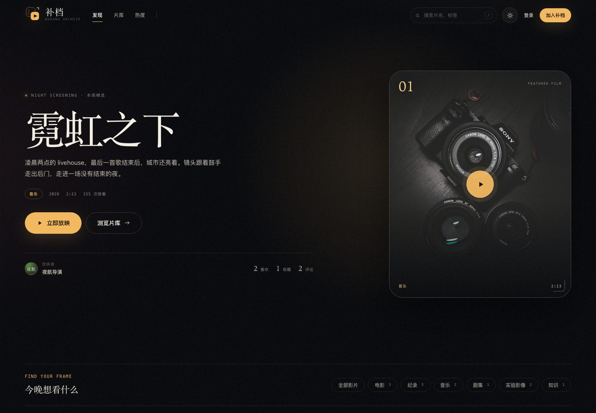
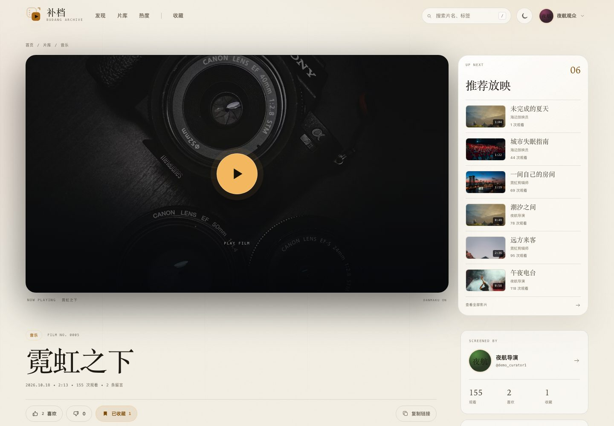
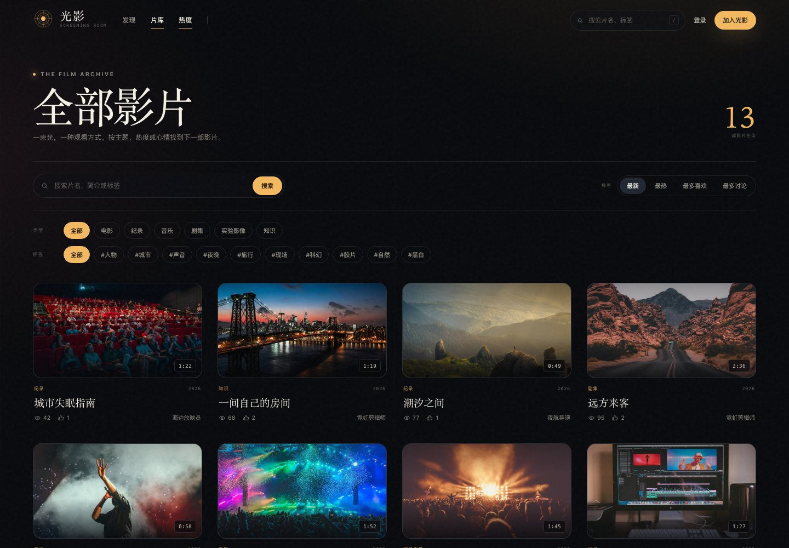
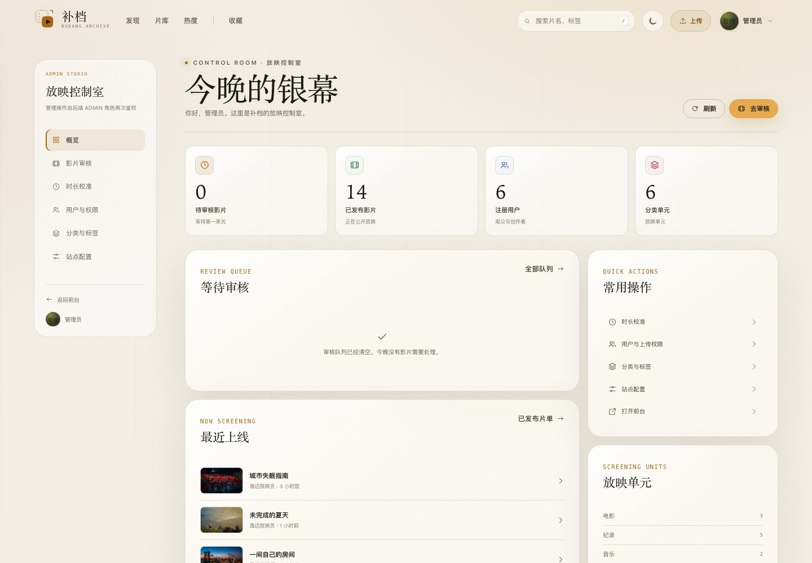
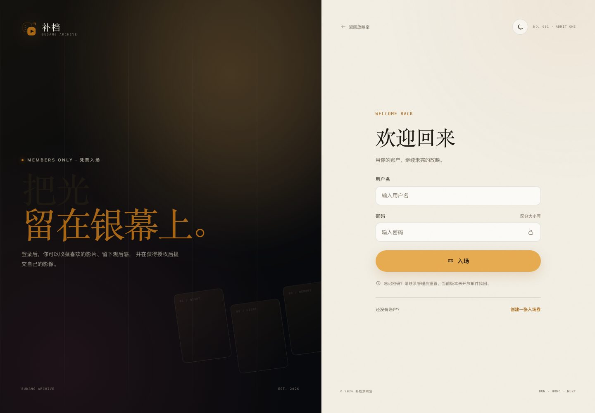
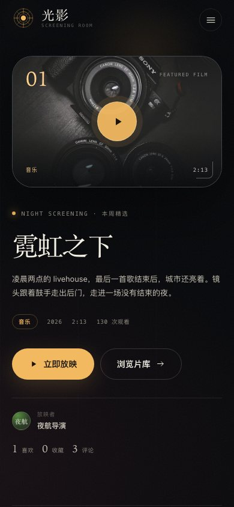
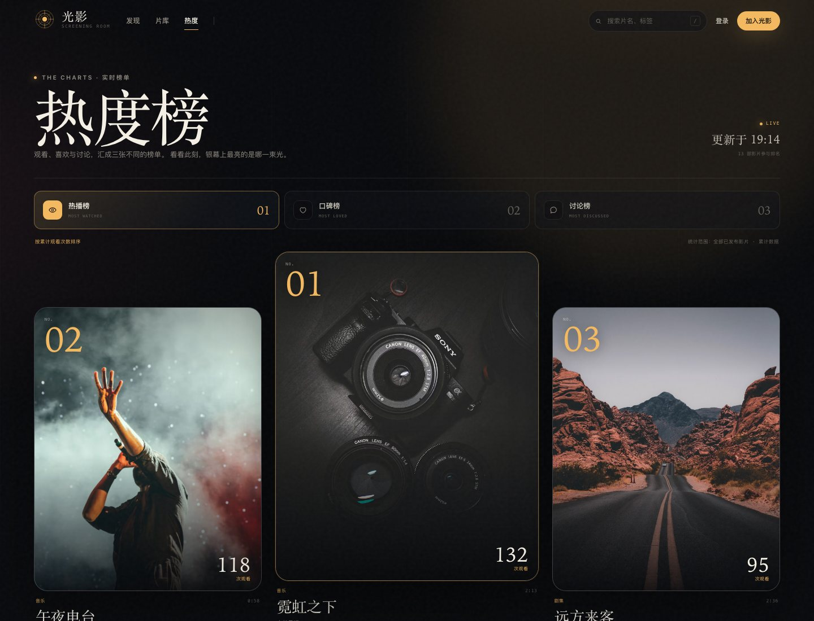
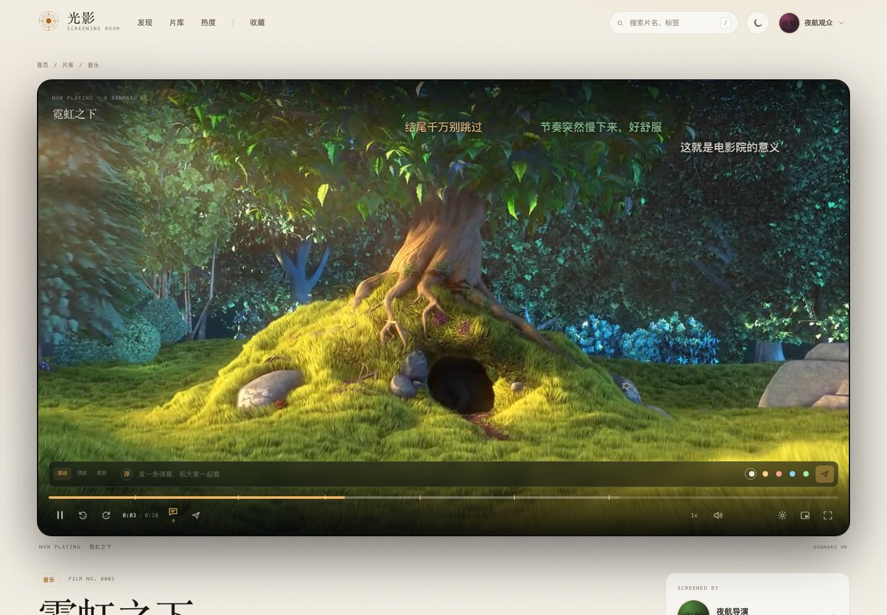
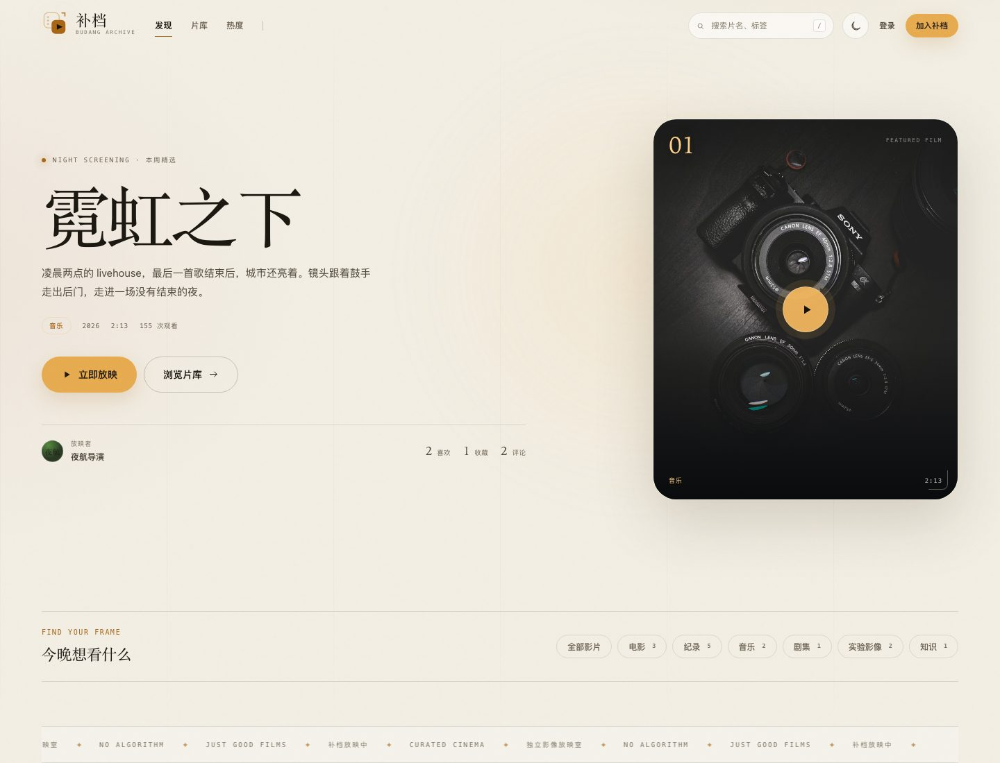

# 光影 Web · Video Frontend

基于 **Nuxt 4 + Vue 3** 的视频站前端，对接主仓库根目录（`..`）的视频站后端。架构参考 `navigation-web` 的 **Nuxt BFF + HttpOnly Cookie** 方案，但 UI 为独立设计的暗色电影放映室风格：暖琥珀光、编辑感衬线字、胶片颗粒与编号片单。

## 界面预览

| 首页 | 影片详情 |
|---|---|
|  |  |
| 片库 | 管理后台 |
|  |  |
| 登录 | 移动端 |
|  |  |

### 热度榜



### 自研播放器



### 亮色主题

暗色 / 亮色双主题，首次打开跟随系统偏好，切换后会记住选择。亮色下仅播放器与认证页左侧海报区保留胶片暗房式的对比。



## 功能

- **首页放映厅**：精选影片 Hero、继续观看、分类/标签入口、正在放映、本周热度、放映单元、标签云。
- **片库**：关键词搜索、分类/标签筛选、最新/最热/最多喜欢/最多讨论排序、分页。
- **热度榜**：独立 `/rankings` 页面，热播榜 / 口碑榜 / 讨论榜切换，Top 3 领奖台与完整排名条形图。
- **影片详情**：播放器、播放计数与进度同步、点赞/点踩、收藏、分享、评论与评论点赞、相关推荐、创作者卡片。
- **账号**：注册/登录/退出、个人资料、头像、上传权限状态、能量余额与流水、修改密码、退出全部设备。
- **创作者**：提交影片（对象存储直传 / 外部链接）、我的影片、审核状态与驳回原因、重新提交、编辑、删除。
- **观众**：我的收藏、观看历史、继续观看、创作者主页。
- **管理后台**：概览、影片审核（通过/驳回/下架/恢复）、影片信息编辑（标题/简介/分类/标签/封面/时长/进度图标）、用户与上传权限、能量调整、分类/标签、站点配置。
- **自研播放器**：自定义控制条、倍速、音量、全屏、画中画、键盘快捷键，支持 4 种主色；管理员可为每部影片选择 6 种内置进度图标或上传自定义图标。
- **时间轴弹幕**：滚动 / 顶部 / 底部三种模式，颜色、字号、透明度、显示区域可调，登录后可实时发送。
- **双主题**：暗色 / 亮色切换，首次跟随系统偏好并持久化选择；所有公开页、账号页与后台均已适配。
- **体验**：响应式布局、Toast、模态框、空状态、加载骨架、路由鉴权、SSR SEO、JSON-LD。

前端位于主仓库 `video-web/` 目录，后端位于仓库根目录，统一版本管理。

## 架构

```text
Browser
  │  same-origin fetch (HttpOnly cookies)
  ▼
Nuxt 4 SSR / Nitro
  ├─ /server/api/auth/*        登录、刷新、登出、密码、当前用户
  ├─ /server/api/backend/*     BFF 代理：路径白名单 + 同源校验 + 注入 Bearer
  └─ SSR pages / composables
          │
          ▼
      Hono backend (:3000)
```

- Access/Refresh Token 只存放在 `HttpOnly; SameSite=Lax` Cookie 中，浏览器 JavaScript 不可读取。
- 生产环境使用 `Secure` Cookie 与 `__Host-` 前缀。
- 浏览器只访问同源 `/api/...`，不直接访问后端，也不需要后端 CORS。
- BFF 只放行前端需要的后端路径与方法；写请求校验 `Origin` / `Sec-Fetch-Site`。
- 客户端 `useApi` 在 401 时执行单飞刷新（Web Locks 协调多标签页），成功后再重试原请求一次。
- 管理页面路由守卫只做体验层拦截，真正权限仍由后端 `ADMIN` 角色校验。

```text
video-web/
  app/
    assets/css/main.css       设计系统与全局样式
    components/               自研播放器、弹幕层、视频卡、评论、弹窗、导航等
    composables/              API、鉴权、上传、Toast、站点配置、播放器偏好
    layouts/                  default / auth / admin
    pages/                    公开页、账号页、创作者页、后台页
    middleware/               登录与管理员路由守卫
    types/                    前后端 DTO 类型
    utils/                    格式化与 URL 工具
  server/
    api/auth/                 BFF 认证路由
    api/backend/[...path].ts  受控后端代理
    utils/                    Cookie、会话刷新、同源校验
  scripts/seed-demo.ts        可选 Demo 数据
```

## 本地开发

先启动主仓库根目录（`..`）的后端：

```bash
cd ..
bun run dev
# http://localhost:3000
```

再启动前端（在 `video-web/` 目录）：

```bash
cp .env.example .env
bun install
bun run dev
# http://localhost:5173
```

可选：如果后端片库为空，可以写入一组 Demo 影片与互动数据：

```bash
bun run seed:demo
```

已有 Demo 影片时，可以在仓库根目录补写一批弹幕：

```bash
bun run db:seed:danmaku
```

Demo 账号（仅本地演示数据）：

| 角色 | 用户名 | 密码 |
|---|---|---|
| 管理员 | `admin` | `Admin123456` |
| 投稿创作者 | `demo_creator` | `Demo123456` |
| 主片单创作者 | `demo_curator1` / `demo_curator2` | `Demo123456` |
| 观众 | `demo_viewer` / `demo_viewer2` | `Demo123456` |

> `seed:demo` 仅在片库为空时执行，避免生产数据被污染。重建 Demo 数据需要先清空后端数据库并重新迁移/seed。

## 环境变量

```env
# 后端地址，仅 Nuxt 服务端访问
NUXT_API_BASE_URL=http://localhost:3000

# 可选：生产对外地址，用于 canonical / og:url
NUXT_PUBLIC_SITE_URL=
```

生产环境不要把 `NUXT_API_BASE_URL` 指向浏览器无法访问的内网地址以外的错误值；该地址由 Nitro 服务端请求。

## 上传说明

- 视频直传需要后端已配置 R2/S3，且 Bucket CORS 允许前端 `PUT` 与 `Content-Type` 头。
- 未配置对象存储时，可以直接切换到「外部视频链接」模式提交可公开访问的 MP4/WebM 地址。
- 上传权限由管理员在后台开通；未开通用户仍可浏览、收藏、评论。
- 私有 Bucket 的播放地址是后端签发的短时 URL；过期后刷新详情页即可重新获取。
- 普通用户的封面/头像上传要求存储桶配置公开访问地址；无公开地址时建议填写图片 URL。

## 验证

```bash
bun run typecheck
bun run build
```

本地已通过真实浏览器验证：首页、片库、详情、登录、注册、账号、上传（外链）、我的影片、收藏、历史、管理后台、移动端菜单；并验证了点赞/收藏切换、评论发布、管理员上传权限开关。

## 生产部署

```bash
docker build -t video-web .
docker run --env-file .env -p 5173:3000 video-web
```

Nitro 产物入口：`bun .output/server/index.mjs`。健康检查：`GET /health`。

生产环境请：
- 使用 HTTPS（生产 Cookie 带 `Secure`）。
- 将 `NUXT_API_BASE_URL` 设置为前端容器可访问的后端地址。
- 在前端入口/网关限制请求体大小，视频文件应直传对象存储，不经过 Nuxt。
- 为 R2/S3 配置精确的 CORS Origin。
- 定期更新 `JWT_SECRET` 与管理员密码（通过 `PATCH /api/auth/password`）。
